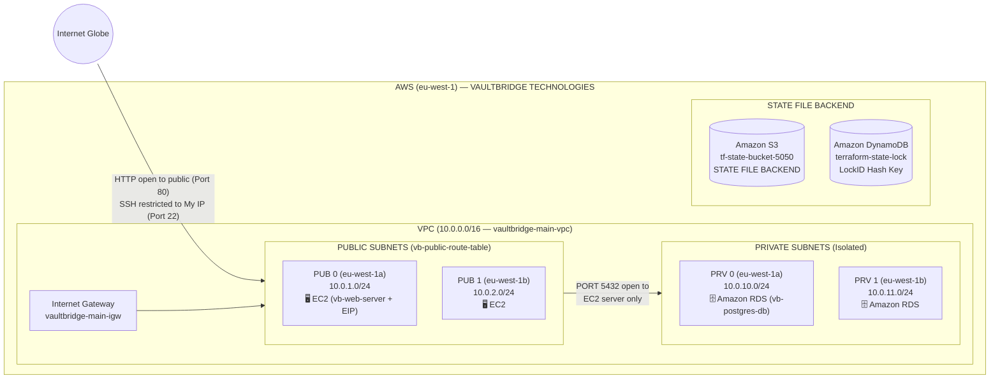

# VaultBridge Infrastructure Modernization: Provisioning a Secure Three-Tier AWS Cloud Environment with Terraform


> **Executive Summary:** VaultBridge Financial Technologies now has a secure, automated, and repeatable cloud infrastructure foundation in AWS (`eu-west-1`), where before it faced fundamental challenges in managing and scaling its cloud workloads. During this modernization effort, we deployed Infrastructure as Code (IaC) using Terraform, established critical architectural patterns including remote state management (`Amazon S3` + `DynamoDB`) and logically separated file structures (`bootstrap/` and `infra/`), implemented variable-driven configurations, and enforced a strict least-privilege security model. This moves the organization away from fragile manual configuration into a modern, automated infrastructure posture, laying the groundwork for future integrations like CI/CD pipelines, autoscaling groups, and container orchestration.
---

## Table of Contents
- [Tools Used](#tools-used)
- [Skills Learned](#skills-learned)
- [1. Problem Statement & Objectives](#1-problem-statement--objectives)
- [2. Architecture & Design Overview](#2-architecture--design-overview)
- [3. Technology Stack & Tooling](#3-technology-stack--tooling)
- [4. Full Documentation Index](#4-full-documentation-index)
- [5. Implementation Walkthrough](#5-implementation-walkthrough)
- [6. Validation, Testing & Proof of Work](#6-validation-testing--proof-of-work)
- [7. Key Challenges & Trade-Offs](#7-key-challenges--trade-offs)
- [8. Future Enhancements](#8-future-enhancements)
- [9. Conclusion](#9-conclusion)
- [Author & Contact](#author--contact)

---

## Tools Used

**Infrastructure, Cloud & Platforms**  


**Application, Scripting & Databases**  


**Security, Version Control & IDE**  


---

## Skills Learned

**Architecture & Engineering**  


**Security Operations & Testing**  


---

## 1. Problem Statement & Objectives

### Background & Risk / Bottleneck
VaultBridge Financial Technologies expanded its cloud workloads on AWS as part of a broader modernization effort. While the expansion supported immediate business requirements, the underlying infrastructure was provisioned manually through human memory and console clicks rather than code, creating a fragile foundation that resulted in a four-hour outage, $214,000 in losses, 23 failed deployments, and a regulatory compliance gap. Three core operational problems followed from this:

* **Manual, non-repeatable provisioning:** Infrastructure changes were made by hand rather than through code, meaning development, staging, and production environments were fundamentally out of sync and highly time-consuming to replicate.
* **Collaboration bottlenecks:** With no remote state management or logically separated file structures, multiple engineers could not safely collaborate on infrastructure updates without the risk of overwriting configurations or causing configuration drift.
* **Unstandardized security controls:** Without a codified, least-privilege security model and variable-driven configurations, cloud resources were frequently deployed with inconsistent and often over-permissive access policies.

### Core Objectives
* **Objective 1 (IaC Foundation):** Prove that a 100% Terraform-managed Infrastructure as Code (IaC) foundation can be established in AWS (`eu-west-1`) and deliver a reliable, repeatable blueprint that the senior engineering team can scale across development, staging, and production environments.
* **Objective 2 (Secure State Management):** Decouple state bootstrapping (`bootstrap/`) from core infrastructure (`infra/`), securing the remote state file in an encrypted, versioned Amazon S3 bucket with public access blocked and DynamoDB state locking enabled.
* **Objective 3 (Multi-Tier Network Isolation & Least Privilege):** Design a segregated VPC (`10.0.0.0/16`) across two Availability Zones with public subnets for the EC2 web tier and isolated private subnets (`publicly_accessible = false`) for the Amazon RDS PostgreSQL tier, restricting SSH (`port 22`) to the engineer's IP and limiting database ingress (`port 5432`) strictly to the EC2 Security Group ID.
* **Objective 4 (Data Encryption & Auditability):** Enforce data-at-rest encryption (`gp3`) across EC2 root volumes and RDS storage arrays, enable PostgreSQL connection logging (`log_connections = 1`), and protect sensitive credentials using `.gitignore` and `sensitive = true` variable flags.

> [!IMPORTANT]
> **Scope Note:** This `README.md` is a comprehensive, all-in-one engineering case study. It consolidates the complete architecture, setup instructions, Terraform code, validation evidence, cost analysis, and troubleshooting lessons without requiring separate `architecture.md`, `setup.md`, or `troubleshooting.md` files.

---

## 2. Architecture & Design Overview

### System Workflow (Constructed from `Vaultbridge.drawio`)



```text
+--------------------------------------------------------------------------------------------------+
| AWS (eu-west-1)                     VAULTBRIDGE TECHNOLOGIES                                     |
|                                                                                                  |
|                 +--------------------------------------------------------------+                 |
|                 | VPC (10.0.0.0/16 - vaultbridge-main-vpc)                     |                 |
|                 |                                                              |                 |
|                 |  +-----------------------+        +-----------------------+  |  +-----------+  |
|                 |  |  +-----------------+  |        |  +-----------------+  |  |  |           |  |
|                 |  |  | [EC2]           |  |        |  | [Amazon RDS]    |  |  |  | [Amazon]  |  |
|   HTTP open     |  |  |          PUB 0  |  |  PORT  |  |          PRV 0  |  |  |  | [  S3  ]  |  |
|   to public     |  |  +-----------------+  |  5432  |  +-----------------+  |  |  |           |  |
|  (Internet) =======>                       |  open  |                       |  |  |   STATE   |  |
|    Globe        |  |  +-----------------+  | to EC2 |  +-----------------+  |  |  |   FILE    |  |
|                 |  |  | [EC2]           |  | server |  | [Amazon RDS]    |  |  |  |  BACKEND  |  |
|                 |  |  |          PUB 1  |  |  only  |  |          PRV 1  |  |  |  |           |  |
|                 |  |  +-----------------+  | -----> |  +-----------------+  |  |  +-----------+  |
|                 |  |     PUBLIC SUBNETS    |        |    PRIVATE SUBNETS    |  |                 |
|                 |  +-----------------------+        +-----------------------+  |                 |
|                 +--------------------------------------------------------------+                 |
+--------------------------------------------------------------------------------------------------+
```

### Architectural Narrative
The design follows three pillars that map to standard multi-tier cloud security and reliability best practices: **public accessibility**, **secure data isolation**, and **infrastructure state management**. Network traffic flows systematically through segregated tiers, which makes the system easy to secure, reason about, and maintain:
* External internet traffic enters the AWS Virtual Private Cloud (`VPC`) via HTTP (`port 80`) and connects to the application server (`EC2` instance) running in the public subnets (`PUB 0` & `PUB 1`).
* The EC2 server processes public requests and acts as a secure bridge to the data layer. It is the only resource permitted to route traffic over `port 5432` to the Amazon RDS database, which is strictly isolated within private subnets (`PRV 0` & `PRV 1`) to protect sensitive data from direct internet exposure.
* Concurrently, an Amazon S3 bucket operates securely outside the VPC as the state file backend, tracking and managing the Terraform infrastructure-as-code deployments alongside DynamoDB state locking.

### Key Design Decisions
1. **Two-Workspace State Bootstrap Separation (`bootstrap/` vs. `infra/`):** You cannot store Terraform state in an S3 bucket that Terraform itself needs to create. The `bootstrap/` workspace runs once with local state to provision the encrypted S3 bucket and DynamoDB lock table, while `infra/` uses the remote S3 backend for all application infrastructure.
2. **Automated State Locking & Encryption:** Using an S3 backend (`tf-state-bucket-5050`) with versioning, `AES256` server-side encryption, and a public access block alongside a DynamoDB table (`terraform-state-lock`) with a `LockID` hash key prevents concurrent state modification collisions and protects sensitive state data from exposure.
3. **Defense-in-Depth Network & Security Group Chaining:** Rather than relying on CIDR-based database rules, the RDS security group (`vb-database-sg`) references the EC2 security group ID (`aws_security_group.ec2_sg.id`) as its sole permitted source on `port 5432`, while RDS is deployed into private subnets with `publicly_accessible = false`.

---

## 3. Technology Stack & Tooling

| Category | Tool / Platform | Role in This Project | Why It Was Chosen |
| :--- | :--- | :--- | :--- |
| **AWS VPC** | `vaultbridge-main-vpc` (`10.0.0.0/16`) | Foundational, isolated virtual network environment containing all deployed infrastructure | Enforces strict network boundaries, DNS resolution, and multi-tier route table isolation |
| **Public Subnets** | `PUB 0` (`10.0.1.0/24`, `eu-west-1a`) & `PUB 1` (`10.0.2.0/24`, `eu-west-1b`) | Network segments exposed to the internet via `vaultbridge-main-igw` to host publicly accessible resources | Multi-AZ layout enables high availability and automatic public IP assignment on launch |
| **Compute Layer** | Amazon EC2 (`t3.micro`, Amazon Linux 2023) + Elastic IP | Application server (`vb-web-server`) in `PUB 0` that receives HTTP traffic and bridges communication to RDS | Dynamically pulls latest AL2023 AMI, encrypts root `gp3` volume (30GB), and boots with `postgresql15` client via `user_data` |
| **Private Subnets** | `PRV 0` (`10.0.10.0/24`, `eu-west-1a`) & `PRV 1` (`10.0.11.0/24`, `eu-west-1b`) | Isolated network segments shielded from the internet with no route to the Internet Gateway | Ensures backend database resources cannot be directly accessed from the public internet |
| **Database Layer** | Amazon RDS PostgreSQL 15 (`db.t3.micro`, `vb-postgres-db`) | Relational database (`vaultbridge_db`) attached to private subnets accepting traffic only from EC2 over `port 5432` | Provides 20GB encrypted `gp3` storage (`storage_encrypted = true`), `publicly_accessible = false`, and `log_connections = 1` audit logging |
| **State Management** | Amazon S3 (`tf-state-bucket-5050`) + DynamoDB (`terraform-state-lock`) | Operates outside the VPC as the remote storage and locking backend for `envs/dev/terraform.tfstate` | Eliminates single-laptop recovery risk and prevents concurrent state corruption across engineering teams |
| **IaC & CLI Tooling** | Terraform CLI (`hashicorp/aws ~> 6.0`), AWS CLI v2, Git, VS Code | Local development, formatting (`fmt`), validation (`validate`), planning (`plan`), and provisioning (`apply`) | Standardizes infrastructure changes through peer-reviewed, version-controlled code |

---

## 4. Full Documentation Index

All project documentation is self-contained within this `README.md`. Below is the repository directory structure across the `bootstrap/` and `infra/` workspaces alongside quick navigation links to the internal modules of this document:

```text
terraform-project/
├── bootstrap/                  # One-time setup: creates S3 bucket and DynamoDB table
│   ├── main.tf                 # S3 bucket + DynamoDB resource definitions
│   ├── variables.tf            # Input variable declarations for bootstrap
│   └── outputs.tf              # Prints bucket name after creation
├── infra/                      # The main infrastructure workspace
│   ├── backend.tf              # Configures remote state in S3
│   ├── providers.tf            # AWS provider configuration and version constraints
│   ├── variables.tf            # Input variable declarations (no values here)
│   ├── vpc.tf                  # VPC, subnets, internet gateway, route tables
│   ├── security_groups.tf      # Firewall rules for EC2 and RDS
│   ├── ec2.tf                  # EC2 instance, key pair, Elastic IP
│   ├── rds.tf                  # RDS instance, subnet group, parameter group
│   ├── outputs.tf              # Post-apply output values
│   └── terraform.tfvars        # Actual variable values (GITIGNORED — never commit this)
├── assets/
│   └── images/                 # Implementation and verification screenshots
├── Vaultbridge.drawio          # Draw.io architecture diagram source file
└── .gitignore                  # Excludes state files, .terraform/, and tfvars from git
```

| Documentation Section | Scope & Contents Covered in This README |
| :--- | :--- |
| [**01. Architecture & Threat Model**](#2-architecture--design-overview) | Network topology (`10.0.0.0/16`), public/private trust boundaries, traffic flow, and security group chaining. |
| [**02. Step-by-Step Implementation**](#5-implementation-walkthrough) | Complete Terraform HCL configurations (`bootstrap/` and `infra/`), CLI commands, and deployment screenshots. |
| [**03. Testing, Validation & Cost Report**](#6-validation-testing--proof-of-work) | End-to-end SSH and `psql` TLSv1.2 verification, S3 state checks, KMS encryption audits, and `$29.08/mo` cost table. |
| [**04. Runbook & Troubleshooting**](#7-key-challenges--trade-offs) | Resolution of `backend.tf` variable initialization errors and EC2 `user_data` Internet Gateway race conditions. |

---

## 5. Implementation Walkthrough

### Phase 1: Environment Setup and Bootstrap (`bootstrap/`)
We began by provisioning the local development environment, installing and verifying the necessary toolchain: Terraform CLI, AWS CLI v2, Git, and VS Code equipped with the HashiCorp Terraform extension. We authenticated using our assigned IAM credentials (`terraform-admin`) via `aws configure` and verified the active session with `aws sts get-caller-identity` (`Account: 865266771761`, `Arn: arn:aws:iam::865266771761:user/terraform-admin`) to ensure secure access rights before touching any cloud resources. To maintain strict version control and security, we initialized the `terraform-project` repository on GitHub and applied a comprehensive `.gitignore` to prevent sensitive assets—namely the `.terraform/` directory, state files (`*.tfstate`), and `terraform.tfvars`—from being exposed.


*Figure 1: Verifying the HashiCorp Terraform extension in VS Code and confirming active IAM credentials via `aws sts get-caller-identity`.*


*Figure 2: Initialized private `terraform-project` GitHub repository showing `bootstrap/`, `infra/`, and `.gitignore`.*

The workspace was logically separated into `bootstrap/` and `infra/` directories to cleanly decouple the state management infrastructure from the core application architecture. Inside the `bootstrap/` directory, we authored `main.tf` to configure the AWS provider (`~> 6.0`) and provision our remote state backend:
* Deployed an Amazon S3 bucket (`tf-state-bucket-5050`) fortified with bucket versioning (`Enabled`), server-side encryption (`AES256`), and a public access block (`block_public_acls = true`, `block_public_policy = true`, `ignore_public_acls = true`, `restrict_public_buckets = true`) to secure the state data.
* Deployed a DynamoDB table (`terraform-state-lock`) utilizing a `LockID` string (`S`) hash key and `PAY_PER_REQUEST` billing mode to prevent concurrent state modification collisions.

<details>
<summary><strong>Click to expand: <code>.gitignore</code>, <code>bootstrap/main.tf</code>, <code>bootstrap/variables.tf</code> & <code>bootstrap/outputs.tf</code></strong></summary>

```gitignore
# .gitignore
# Local .terraform directories
**/.terraform/*

# .tfstate files
*.tfstate
*.tfstate.*

# Crash log files
crash.log
crash.*.log

# Exclude all .tfvars files, which are likely to contain sensitive data, such as
# password, private keys, and other secrets. These should not be part of version
# control as they are data points which are potentially sensitive and subject
# to change depending on the environment.
*.tfvars
*.tfvars.json

# Ignore override files as they are usually used to override resources locally and so
# are not checked in
override.tf
override.tf.json
*_override.tf
*_override.tf.json

# Ignore transient lock info files created by terraform apply
.terraform.tfstate.lock.info
*.terraform.lock.hcl

# Ignore CLI configuration files
.terraformrc
terraform.rc
```

```hcl
# bootstrap/main.tf
/* define the AWS provider, S3 bucket resource with versioning, server-side encryption, 
 and public access block, and the DynamoDB table with LockID hash key. */

terraform {
  required_providers {
    aws = {
      source  = "hashicorp/aws"
      version = "~> 6.0"
    }
  }
}

# Configure the AWS Provider
provider "aws" {
  region = var.aws_region
}

# Create s3 with versioning enabled
resource "aws_s3_bucket" "tf_state" {
  bucket = var.bucket_name

  tags = {
    Name = "Terraform State Bucket"
  }
}

# enable versioning
resource "aws_s3_bucket_versioning" "versioning_tf_state" {
  bucket = aws_s3_bucket.tf_state.id
  versioning_configuration {
    status = "Enabled"
  }
}

# Enable server-side encryption by default
resource "aws_s3_bucket_server_side_encryption_configuration" "tf_state_crypto" {
  bucket = aws_s3_bucket.tf_state.id

  rule {
    apply_server_side_encryption_by_default {
      sse_algorithm = "AES256"
    }
  }
}

# Block all public access to the S3 bucket to prevent accidental data leaks
resource "aws_s3_bucket_public_access_block" "tf_state_access" {
  bucket                  = aws_s3_bucket.tf_state.id
  block_public_acls       = true
  block_public_policy     = true
  ignore_public_acls      = true
  restrict_public_buckets = true
}

# DynamoDB table with LockID hash key
resource "aws_dynamodb_table" "tf_state_lock" {
  name         = var.dynamodb_table_name
  billing_mode = "PAY_PER_REQUEST"
  hash_key     = "LockID"

  attribute {
    name = "LockID"
    type = "S"
  }

  tags = {
    Name        = "Terraform State Lock Table"
    Description = "Used for Terraform state locking"
  }
}
```

```hcl
# bootstrap/variables.tf
variable "bucket_name" {
  description = "The globally unique name for the S3 bucket storing Terraform state"
  type        = string
}

variable "dynamodb_table_name" {
  description = "The name of the DynamoDB table used for state locking"
  type        = string
  default     = "terraform-state-lock"
}

variable "aws_region" {
  description = "The AWS region to deploy resources into"
  type        = string
  default     = "eu-west-1"
}
```

```hcl
# bootstrap/outputs.tf
output "state_s3_name" {
  value       = aws_s3_bucket.tf_state.bucket
  description = "Output name of terraform state of bucket"
}
```

</details>

After running the standard `terraform init`, `terraform fmt`, and `terraform validate` workflow, we generated a `terraform plan` and reviewed it as a team to confirm exactly five resources would be built (`Plan: 5 to add, 0 to change, 0 to destroy`). Upon agreement, we executed `terraform apply` and verified the successful creation of both the S3 bucket and DynamoDB table directly within the AWS Console.


*Figure 3: Running `terraform init` (installing `hashicorp/aws v6.55.0`), `terraform fmt`, `terraform validate`, and `terraform plan` inside `bootstrap/`.*


*Figure 4: Reviewing the `bootstrap/` execution plan confirming `Plan: 5 to add, 0 to change, 0 to destroy`.*


*Figure 5: AWS S3 Console confirming creation of `tf-state-bucket-5050` in `eu-west-1` with Bucket Versioning `Enabled`.*


*Figure 6: AWS DynamoDB Console confirming `terraform-state-lock` is `Active` with Partition key `LockID (S)`.*

---

### Phase 2: Backend & VPC (`infra/backend.tf`, `providers.tf`, `variables.tf`, `vpc.tf`)
We transitioned to the `infra/` directory to establish the core infrastructure, beginning with the remote state configuration:
* In `backend.tf`, we configured the S3 backend utilizing the secure bucket (`tf-state-bucket-5050`) and DynamoDB state-locking table (`terraform-state-lock`) provisioned during the bootstrap phase, setting the state file key to `envs/dev/terraform.tfstate` and strictly enforcing encryption (`encrypt = true`).
* We defined our AWS provider and required version constraints (`~> 6.0`) in `providers.tf`.
* To maintain secure and modular code, we declared our deployment parameters in `variables.tf`, ensuring that `db_username`, `db_password`, and `my_ip_cidr` were flagged with `sensitive = true`, alongside `aws_region`. We injected our local values into `terraform.tfvars`—populating our specific public IP address verified via `curl ifconfig.me`—ensuring this file was strictly excluded from version control.
* In `vpc.tf`, we defined a custom VPC (`vaultbridge-main-vpc`) utilizing a `10.0.0.0/16` CIDR block (`enable_dns_hostnames = true`, `enable_dns_support = true`) and designed for high availability by provisioning two public subnets (`10.0.1.0/24`, `10.0.2.0/24`) and two private subnets (`10.0.10.0/24`, `10.0.11.0/24`) across distinct Availability Zones (`eu-west-1a` and `eu-west-1b`).
* To enable external connectivity for the public web tier, we deployed an Internet Gateway (`vaultbridge-main-igw`), created a public route table (`vb-public-route-table`) routing non-local traffic (`0.0.0.0/0`) to the gateway, and established route table associations for both public subnets.
* Finally, we executed `terraform init` to initialize the working directory and ran `terraform fmt`, `validate`, and `plan` to review the pending resource creation map.

<details>
<summary><strong>Click to expand: <code>infra/backend.tf</code>, <code>infra/providers.tf</code>, <code>infra/variables.tf</code> & <code>infra/vpc.tf</code></strong></summary>

```hcl
# infra/backend.tf
terraform {
  backend "s3" {
    bucket         = "tf-state-bucket-5050"
    dynamodb_table = "terraform-state-lock"
    key            = "envs/dev/terraform.tfstate"
    region         = "eu-west-1"
    encrypt        = true
  }
}
```

```hcl
# infra/providers.tf
terraform {
  required_providers {
    aws = {
      source  = "hashicorp/aws"
      version = "~> 6.0"
    }
  }
}

# Configure the AWS Provider
provider "aws" {
  region = var.aws_region
}
```

```hcl
# infra/variables.tf
variable "aws_region" {
  description = "The AWS region to deploy resources into"
  type        = string
  default     = "eu-west-1"
}

variable "bucket_name" {
  description = "The globally unique name for the S3 bucket storing Terraform state"
  type        = string
}

variable "dynamodb_table_name" {
  description = "The name of the DynamoDB table used for state locking"
  type        = string
  default     = "terraform-state-lock"
}

variable "my_ip_cidr" {
  description = "Local ip of device"
  type        = string
  sensitive   = true
}

variable "db_username" {
  description = "Database username"
  type        = string
  sensitive   = true
}

variable "db_password" {
  description = "Database Password"
  type        = string
  sensitive   = true
}
```

```hcl
# infra/vpc.tf
# Dynamically fetch available AZs in our provider's region
data "aws_availability_zones" "available" {
  state = "available"
}

# -----------------------------------------------------------
# VPC
# -----------------------------------------------------------
resource "aws_vpc" "main" {
  cidr_block           = "10.0.0.0/16"
  enable_dns_hostnames = true
  enable_dns_support   = true

  tags = {
    Name = "vaultbridge-main-vpc"
  }
}

# -----------------------------------------------------------
# INTERNET GATEWAY
# -----------------------------------------------------------
resource "aws_internet_gateway" "gw" {
  vpc_id = aws_vpc.main.id

  tags = {
    Name = "vaultbridge-main-igw"
  }
}

# -----------------------------------------------------------
# SUBNETS
# -----------------------------------------------------------
# Public Subnet 1 (AZ A)
resource "aws_subnet" "public_1" {
  vpc_id                  = aws_vpc.main.id
  cidr_block              = "10.0.1.0/24"
  availability_zone       = data.aws_availability_zones.available.names[0]
  map_public_ip_on_launch = true # Automatically assigns public IPs to instances launched here

  tags = {
    Name = "vb-public-subnet-1"
  }
}

# Public Subnet 2 (AZ B)
resource "aws_subnet" "public_2" {
  vpc_id                  = aws_vpc.main.id
  cidr_block              = "10.0.2.0/24"
  availability_zone       = data.aws_availability_zones.available.names[1]
  map_public_ip_on_launch = true

  tags = {
    Name = "vb-public-subnet-2"
  }
}

# Private Subnet 1 (AZ A)
resource "aws_subnet" "private_1" {
  vpc_id            = aws_vpc.main.id
  cidr_block        = "10.0.10.0/24"
  availability_zone = data.aws_availability_zones.available.names[0]

  tags = {
    Name = "vb-private-subnet-1"
  }
}

# Private Subnet 2 (AZ B)
resource "aws_subnet" "private_2" {
  vpc_id            = aws_vpc.main.id
  cidr_block        = "10.0.11.0/24"
  availability_zone = data.aws_availability_zones.available.names[1]

  tags = {
    Name = "vb-private-subnet-2"
  }
}

# -----------------------------------------------------------
# ROUTING (Public Route Table & Route to IGW)
# -----------------------------------------------------------
resource "aws_route_table" "public" {
  vpc_id = aws_vpc.main.id

  # Send all non-local traffic out to the Internet Gateway
  route {
    cidr_block = "0.0.0.0/0"
    gateway_id = aws_internet_gateway.gw.id
  }

  tags = {
    Name = "vb-public-route-table"
  }
}

# -----------------------------------------------------------
# ROUTE TABLE ASSOCIATIONS
# -----------------------------------------------------------
# Associate Public Subnet 1 to the Public Route Table
resource "aws_route_table_association" "public_1" {
  subnet_id      = aws_subnet.public_1.id
  route_table_id = aws_route_table.public.id
}

# Associate Public Subnet 2 to the Public Route Table
resource "aws_route_table_association" "public_2" {
  subnet_id      = aws_subnet.public_2.id
  route_table_id = aws_route_table.public.id
}
```

</details>


*Figure 7: Initializing the remote S3 backend in `infra/` via `terraform init`.*


*Figure 8: Reviewing the `terraform plan` output for `aws_vpc.main` (`10.0.0.0/16`, `vaultbridge-main-vpc`) and subnet definitions.*

> **Lesson learned, carried into the rule:**  
> After writing the Terraform code for the provisioning of the backend and VPC, it was time to initialize Terraform in our `/infra` directory. After running the `terraform init` command, an error occurred (`Error: Variables not allowed — on backend.tf line 3, in terraform: bucket = var.bucket_name`). *"The problem was that we had used variables in our backend code. The fix was to hardcode the backend values because Terraform needs to connect to the backend during the initialization phase to find the state file, which happens entirely before it parses or evaluates any variables."*


*Figure 9: Diagnostic capture of `Error: Variables not allowed` on `backend.tf` line 3 during `terraform init` before hardcoding backend values.*

---

### Phase 3: Security Groups (`infra/security_groups.tf`)
We commenced the security layer configuration by defining strict, least-privilege access controls for the architecture:
* **Web Tier (`vb-ec2-sg`):** Provisioned an EC2 security group permitting global inbound HTTP traffic on `port 80` (`0.0.0.0/0`), while rigidly restricting SSH access on `port 22` to our specific local IP address (`var.my_ip_cidr`), injected through our local `terraform.tfvars` file. All outbound traffic (`-1`) from the EC2 instance was permitted.
* **Data Layer (`vb-database-sg`):** Configured an RDS security group that explicitly limits inbound traffic on `port 5432` to originate solely from the EC2 security group ID (`security_groups = [aws_security_group.ec2_sg.id]`) rather than an open CIDR range, securely sealing the database from external network vectors.
* **Peer Review Exercise:** Executed `terraform plan` to verify these precise access constraints and conducted a peer review exercise by swapping configurations with a team partner to cross-examine the access rules for potential vulnerabilities or misconfigurations prior to application.

<details>
<summary><strong>Click to expand: <code>infra/security_groups.tf</code></strong></summary>

```hcl
# infra/security_groups.tf
# -----------------------------------------------------------
# EC2 SECURITY GROUP
# -----------------------------------------------------------
resource "aws_security_group" "ec2_sg" {
  name        = "vb-ec2-sg"
  description = "Allow inbound HTTP from anywhere and SSH from my IP"
  vpc_id      = aws_vpc.main.id

  # Inbound: SSH restricted to my IP
  ingress {
    description = "SSH access from personal IP"
    from_port   = 22
    to_port     = 22
    protocol    = "tcp"
    cidr_blocks = [var.my_ip_cidr]
  }

  # Inbound: HTTP open to the public
  ingress {
    description = "HTTP access from the internet"
    from_port   = 80
    to_port     = 80
    protocol    = "tcp"
    cidr_blocks = ["0.0.0.0/0"]
  }

  # Outbound: Allow all traffic leaving the EC2 instance
  egress {
    description = "Allow all outbound traffic"
    from_port   = 0
    to_port     = 0
    protocol    = "-1"
    cidr_blocks = ["0.0.0.0/0"]
  }

  tags = {
    Name = "vb-ec2-sg"
  }
}

# -----------------------------------------------------------
# RDS DATABASE TIER SECURITY GROUP
# -----------------------------------------------------------
resource "aws_security_group" "rds_sg" {
  name        = "vb-database-sg"
  description = "Allow PostgreSQL (5432) inbound traffic strictly from the ec2"
  vpc_id      = aws_vpc.main.id

  # Inbound: PostgreSQL access restricted to the EC2 Security Group ID
  ingress {
    description     = "PostgreSQL access from ec2"
    from_port       = 5432
    to_port         = 5432
    protocol        = "tcp"
    security_groups = [aws_security_group.ec2_sg.id]
  }

  # Outbound: Allow all traffic leaving the database
  egress {
    description = "Allow all outbound traffic"
    from_port   = 0
    to_port     = 0
    protocol    = "-1"
    cidr_blocks = ["0.0.0.0/0"]
  }

  tags = {
    Name = "vb-database-sg"
  }
}
```

</details>


*Figure 10: `terraform plan` output verifying `aws_security_group.ec2_sg` (`vb-ec2-sg`) with sensitive ingress value masking.*


*Figure 11: `terraform plan` output verifying `aws_security_group.rds_sg` restricting `port 5432` inbound strictly to `ec2_sg`.*

---

### Phase 4: EC2 Server (`infra/ec2.tf`)
We advanced to the compute provisioning phase by configuring `infra/ec2.tf`:
* Defined a data source (`data.aws_ami.amazon_linux_2023`) to dynamically fetch the latest Amazon Linux 2023 AMI, filtering specifically for `al2023-ami-*-x86_64` owned by `amazon`.
* Established an `aws_key_pair` resource (`deployer_key` / `vb-ec2-key`) referencing our local public key file (`C:/Users/HP/.ssh/id_rsa.pub`) to facilitate secure shell access.
* Defined `aws_instance.web` (`vb-web-server`) utilizing a `t3.micro` instance type, explicitly deploying it into our first public subnet (`aws_subnet.public_1.id`) and attaching `aws_security_group.ec2_sg.id`.
* Enforced data-at-rest security by configuring an encrypted 30GB `gp3` root volume (`encrypted = true`), and attached an Elastic IP (`aws_eip.web_eip`) to provide a persistent public endpoint.
* Injected a `user_data` script to automatically execute `yum update -y` and `yum install -y postgresql15` during initial boot, paired with `depends_on = [aws_internet_gateway.gw]`, then executed `terraform plan` and `terraform apply`.

<details>
<summary><strong>Click to expand: <code>infra/ec2.tf</code></strong></summary>

```hcl
# infra/ec2.tf
# -----------------------------------------------------------
# DATA SOURCE: LATEST AMAZON LINUX 2023 AMI
# -----------------------------------------------------------
data "aws_ami" "amazon_linux_2023" {
  most_recent = true
  owners      = ["amazon"]

  filter {
    name   = "name"
    values = ["al2023-ami-*-x86_64"]
  }

  filter {
    name   = "virtualization-type"
    values = ["hvm"]
  }
}

# -----------------------------------------------------------
# SSH KEY PAIR
# -----------------------------------------------------------
resource "aws_key_pair" "deployer_key" {
  key_name   = "vb-ec2-key"
  public_key = file("C:/Users/HP/.ssh/id_rsa.pub")
}

# -----------------------------------------------------------
# EC2 INSTANCE
# -----------------------------------------------------------
resource "aws_instance" "web" {
  ami           = data.aws_ami.amazon_linux_2023.id
  instance_type = "t3.micro"

  # first public subnet created in the VPC setup
  subnet_id = aws_subnet.public_1.id

  # EC2 security group created in the SG setup
  vpc_security_group_ids = [aws_security_group.ec2_sg.id]
  key_name               = aws_key_pair.deployer_key.key_name

  root_block_device {
    volume_type = "gp3"
    encrypted   = true
    volume_size = 30 # Optional: Default for AL2023 is 8GB
  }

  user_data = <<-EOF
              #!/bin/bash
              yum update -y
              yum install -y postgresql15
              EOF

  # EXPLICIT DEPENDENCY: Wait for the network to have internet access
  # before booting the instance so the yum script doesn't fail.
  depends_on = [
    aws_internet_gateway.gw
  ]

  tags = {
    Name = "vb-web-server"
  }
}

# -----------------------------------------------------------
# ELASTIC IP (EIP)
# -----------------------------------------------------------
resource "aws_eip" "web_eip" {
  instance = aws_instance.web.id
  # 'domain' replaces the deprecated 'vpc = true' argument in newer AWS providers
  domain = "vpc"

  tags = {
    Name = "vb-web-server-eip"
  }
}
```

</details>


*Figure 12: Verifying `aws_key_pair.deployer_key` (`vb-ec2-key`) and EC2 instance placement in `terraform plan` prior to execution.*

---

### Phase 5: RDS Database & Project Outputs (`infra/rds.tf`, `outputs.tf`)
We concluded the core infrastructure deployment by focusing on the secure database tier in `infra/rds.tf` and outputs in `infra/outputs.tf`:
* Established an `aws_db_subnet_group` (`vb-main-rds-subnet-group`) spanning both private subnets (`aws_subnet.private_1.id`, `aws_subnet.private_2.id`) to ensure the database remained strictly isolated from the public network.
* Created a custom `aws_db_parameter_group` (`postgres15-log-connections-pg`) for `postgres15`, specifically enabling the `log_connections = "1"` parameter to enhance audit logging capabilities.
* Provisioned `aws_db_instance.postgres` (`vb-postgres-db`), selecting PostgreSQL 15 on a `db.t3.micro` instance backed by 20GB of encrypted `gp3` storage (`storage_encrypted = true`), explicitly setting `publicly_accessible = false`, configuring `skip_final_snapshot = true`, and dynamically sourcing `db_username` and `db_password` from declared sensitive variables.
* Authored `infra/outputs.tf` to expose `ec2_public_ip`, `rds_endpoint`, and `vpc_id`, verified `publicly_accessible = false` in `terraform plan`, and executed `terraform apply -auto-approve` to finalize the infrastructure setup.

<details>
<summary><strong>Click to expand: <code>infra/rds.tf</code> & <code>infra/outputs.tf</code></strong></summary>

```hcl
# infra/rds.tf
# -----------------------------------------------------------
# RDS DB SUBNET GROUP
# -----------------------------------------------------------
resource "aws_db_subnet_group" "rds_subnet_group" {
  name        = "vb-main-rds-subnet-group"
  description = "Subnet group for RDS spanning both private subnets"
  # two private subnets from VPC setup
  subnet_ids = [aws_subnet.private_1.id, aws_subnet.private_2.id]

  tags = {
    Name = "vb-main-rds-subnet-group"
  }
}

# -----------------------------------------------------------
# RDS DB PARAMETER GROUP
# -----------------------------------------------------------
resource "aws_db_parameter_group" "rds_pg" {
  name   = "postgres15-log-connections-pg"
  family = "postgres15"

  parameter {
    name  = "log_connections"
    value = "1" # 1 translates to "on" in PostgreSQL
  }

  tags = {
    Name = "postgres15-log-connections-pg"
  }
}

# -----------------------------------------------------------
# RDS DATABASE INSTANCE
# -----------------------------------------------------------
resource "aws_db_instance" "postgres" {
  identifier          = "vb-postgres-db"
  engine              = "postgres"
  engine_version      = "15"
  instance_class      = "db.t3.micro"
  allocated_storage   = 20
  storage_type        = "gp3"
  storage_encrypted   = true
  publicly_accessible = false
  skip_final_snapshot = true # for this exercise, not recommended

  # Attaching the subnet group and parameter group defined above
  db_subnet_group_name = aws_db_subnet_group.rds_subnet_group.name
  parameter_group_name = aws_db_parameter_group.rds_pg.name

  # Attaching the database security group
  vpc_security_group_ids = [aws_security_group.rds_sg.id]

  # Initial Database Setup
  db_name = "vaultbridge_db"

  # Use a variable for username and password.
  username = var.db_username
  password = var.db_password

  tags = {
    Name = "vb-postgres-db"
  }
}
```

```hcl
# infra/outputs.tf
# -----------------------------------------------------------
# PROJECT OUTPUTS
# -----------------------------------------------------------
output "vpc_id" {
  description = "ID of created VPC"
  value       = aws_vpc.main.id
}

output "ec2_public_ip" {
  description = "The static Elastic IP address attached to the EC2 server"
  value       = aws_eip.web_eip.public_ip
}

output "rds_endpoint" {
  description = "The connection endpoint for the RDS PostgreSQL database"
  value       = aws_db_instance.postgres.endpoint
}
```

</details>


*Figure 13: Reviewing `terraform plan` for `aws_db_instance.postgres` confirming `db_name = "vaultbridge_db"` and `db_subnet_group_name = "vb-main-rds-subnet-group"`.*


*Figure 14: Executing `terraform apply -auto-approve` in `infra/`, completing `aws_db_instance.postgres` creation after `6m27s` and outputting `ec2_public_ip = "54.228.197.21"`, `rds_endpoint = "vb-postgres-db.czek08ukwcnb.eu-west-1.rds.amazonaws.com:5432"`, and `vpc_id = "vpc-0bc25aa9c22c52618"`.*

---

## 6. Validation, Testing & Proof of Work

To verify that the implementation met all core architectural and security objectives, a full end-to-end validation sequence was executed.

### Baseline vs. Post-Implementation Results (Success Metrics)

| Success Metric | Baseline (Before) | Target | Post-Implementation (After) | Outcome |
| :--- | :--- | :--- | :--- | :--- |
| **Infrastructure as Code (IaC)** | Manual console clicks; 23 failed deployments & drift | 100% of resources deployed and managed via Terraform | All 19 cloud resources/data sources codified and tracked in Terraform | **Met** |
| **State Management** | Local/untracked state; collaboration collisions | Remote state securely stored in S3 with DynamoDB locking | `terraform.tfstate` (`43,538` bytes) stored in `s3://tf-state-bucket-5050/envs/dev/` with `terraform-state-lock` | **Met** |
| **Network Segregation** | Unstandardized network boundaries | RDS deployed in private subnets (`publicly_accessible = false`) | `vb-postgres-db` isolated in `vb-private-subnet-1` & `2` with `publicly_accessible = false` | **Met** |
| **Least Privilege Access** | Over-permissive access policies | SSH restricted to user IP; RDS ingress limited to EC2 Security Group | `port 22` restricted to `var.my_ip_cidr`; `port 5432` restricted strictly to `ec2_sg` (`sg-0419b296fa39bd2cb`) | **Met** |
| **Data Encryption** | Unstandardized volume encryption | Storage encryption enabled on both EC2 root volumes and RDS | KMS `gp3` encryption active on EC2 (`vol-0dd8871f2c082fe12`) and RDS (`storage_encrypted = true`) | **Met** |
| **End-to-End Connectivity** | 4-hour outage & manual configuration errors | Successful SSH into EC2 and `psql` connection to RDS | Authenticated into EC2 (`54.228.197.21`) via SSH and connected to RDS (`vaultbridge_db`) over TLSv1.2 | **Met** |

### Monthly Estimated Running Cost (`eu-west-1`)
For this proof of concept, the running cost was close to zero by design (when torn down after validation). Based on standard AWS On-Demand pricing for a 730-hour month in `eu-west-1`, the modernized infrastructure costs approximately **$29.08 per month**:

| Component | Specification | Estimated Monthly Cost |
| :--- | :--- | :--- |
| **Amazon EC2 Compute** | 1x `t3.micro` instance running 24/7 ($0.0114/hour) | $8.32 |
| **EC2 Storage (EBS)** | ~8GB `gp3` root volume (~$0.088/GB-month) | ~$0.70 |
| **Elastic IP (EIP)** | 1x Public IPv4 address ($0.005/hour) | $3.65 |
| **Amazon RDS Compute** | 1x `db.t3.micro` PostgreSQL instance (~$0.019/hour) | ~$13.87 |
| **RDS Storage** | 20GB `gp3` storage (~$0.127/GB-month) | ~$2.54 |
| **State Management** | S3 Bucket + DynamoDB Lock Table | <$0.10 |
| **VPC & Networking** | VPC, Subnets, IGW, Security Groups | Free |
| **Total Estimated Cost** | **Monthly Estimated Running Cost (`eu-west-1`)** | **~$29.08/month** |

---

### Visual Evidence

#### Step 1: End-to-End SSH & Private RDS PostgreSQL Connectivity
First, we authenticated into our public EC2 instance (`ec2-54-228-197-21.eu-west-1.compute.amazonaws.com` / `ip-10-0-1-12`) via SSH. From within the secure EC2 environment, we established a connection to the private RDS database using `psql -h vb-postgres-db.czek08ukwcnb.eu-west-1.rds.amazonaws.com -U chinaza -d vaultbridge_db`, confirming that our network routing and security group rules functioned as designed over an encrypted TLSv1.2 connection (`cipher: ECDHE-RSA-AES256-GCM-SHA384`) and listing the databases with `\l`.


*Figure 15: Authenticating into the public Amazon Linux 2023 EC2 instance (`54.228.197.21` / `ip-10-0-1-12`) via SSH.*


*Figure 16: Connecting from the EC2 instance to the private RDS PostgreSQL database (`vaultbridge_db`) via `psql` and listing databases with `\l`.*

#### Step 2: Remote State Backend Integrity Verification
Next, we verified the integrity of our remote state backend by running `aws s3 ls s3://tf-state-bucket-5050/envs/dev/` to ensure the Terraform state file (`43538 terraform.tfstate`) was safely stored in our S3 bucket, followed by running `terraform state list` to review all managed resources.


*Figure 17: Verifying `terraform.tfstate` inside `s3://tf-state-bucket-5050/envs/dev/` and listing managed resources via `terraform state list`.*

#### Step 3: AWS Console Security & Network Topology Audit
Following the connectivity checks, we conducted a comprehensive security audit of the deployed infrastructure in the AWS Management Console, confirming all VPC, Subnet, Route Table, Internet Gateway, and RDS resources were running and adhered strictly to the principle of least privilege.


*Figure 18: AWS VPC Dashboard confirming `vpc-0bc25aa9c22c52618 / vaultbridge-main-vpc` (`10.0.0.0/16`) is `Available`.*


*Figure 19: VPC Resource Map showing `vaultbridge-main-vpc`, the 4 public/private subnets across `eu-west-1a` and `eu-west-1b`, and the 2 route tables.*


*Figure 20: VPC Resource Map confirming `vb-public-route-table` routes to `vaultbridge-main-igw` while private subnets remain isolated on `rtb-0b1751d513e84def6`.*


*Figure 21: AWS VPC Subnets view confirming `vb-public-subnet-1`, `vb-private-subnet-1`, `vb-private-subnet-2`, and `vb-public-subnet-2` are `Available`.*


*Figure 22: Inspecting `subnet-0d47feba57a52bf3c` (`vb-private-subnet-1`) related resources confirming `vb-postgres-db` and `vb-main-rds-subnet-group` attachment.*


*Figure 23: Amazon RDS Console confirming `vb-postgres-db` (`db.t3.micro`, PostgreSQL, `eu-west-1a`) is `Available` with `Internet access gateway: Disabled`.*

#### Step 4: Data-at-Rest Encryption & Final Audit Records (`terraform state show`, `output`, `state list`)
Furthermore, we verified that data-at-rest encryption was actively enabled across both the EC2 root volumes (`terraform state show aws_instance.web`) and the RDS storage arrays (`terraform state show aws_db_instance.postgres`). To conclude the validation sequence, we executed `terraform output` to capture essential environment endpoints and ran `terraform state list` to save the complete list of managed resources for our audit records.


*Figure 24: Running `terraform state show aws_instance.web` to confirm `root_block_device` encryption (`encrypted = true`, `volume_type = "gp3"`, `volume_size = 30`, `kms_key_id`).*


*Figure 25: Running `terraform state show aws_db_instance.postgres` to confirm `publicly_accessible = false`, `storage_encrypted = true`, and `storage_type = "gp3"`.*


*Figure 26: Executing `terraform output` to capture `ec2_public_ip`, `rds_endpoint`, and `vpc_id`.*


*Figure 27: Executing `terraform state list` to record all 19 managed resources and data sources.*

---

## 7. Key Challenges & Trade-Offs

> [!NOTE]
> Documenting roadblocks and how they were resolved demonstrates real-world cloud engineering and troubleshooting methodology.

* **Challenge 1: Network Dependency Timing and User Data Execution**
  * *Issue:* During the initial deployment attempts, the EC2 instance successfully provisioned but failed to execute the `user_data` script (which was tasked with running `yum update -y` and installing `postgresql15`). Because Terraform provisions resources in parallel where possible, the EC2 instance booted and attempted to pull packages from the internet before the `aws_internet_gateway` was fully attached and routing was established.
  * *Resolution:* Explicit dependencies must be managed when implicit dependencies are insufficient. Adding a `depends_on = [aws_internet_gateway.gw]` argument to the EC2 resource block (`aws_instance.web`) ensures that the instance will not boot—and therefore will not trigger the `user_data` execution—until the VPC has a confirmed outbound internet route.
* **Challenge 2: Variables Not Allowed in Terraform Backend Configuration**
  * *Issue:* After writing the Terraform code for the backend and VPC, running `terraform init` in `/infra` failed with `Error: Variables not allowed — on backend.tf line 3, in terraform: bucket = var.bucket_name`.
  * *Resolution:* Hardcoded the backend values (`bucket = "tf-state-bucket-5050"`, `dynamodb_table = "terraform-state-lock"`, `key = "envs/dev/terraform.tfstate"`, `region = "eu-west-1"`, `encrypt = true`) in `infra/backend.tf` because Terraform needs to connect to the backend during the initialization phase to find the state file, which happens entirely before it parses or evaluates any variables.

---

## 8. Future Enhancements

To elevate the current VaultBridge deployment from a functional proof-of-concept to a hardened, production-ready environment, the following architectural and code-level enhancements are planned:

### 1. High Availability & Scalability
- [ ] **Load Balancing and Auto Scaling:** Transition the web tier from a single, standalone EC2 instance to an Auto Scaling Group (ASG) deployed behind an Application Load Balancer (ALB) to automatically scale compute resources based on traffic demands and eliminate a single point of failure.
- [ ] **Multi-AZ Database Deployment:** Update the RDS configuration by setting `multi_az = true`. While the single-AZ setup used in the POC minimizes costs, enabling Multi-AZ provides synchronous data replication and automatic failover for fault tolerance.

### 2. Enhanced Security Posture
- [ ] **Advanced Secrets Management:** Instead of passing `db_username` and `db_password` via local `terraform.tfvars` files, integrate AWS Secrets Manager or HashiCorp Vault directly into the Terraform configuration to encrypt credentials, enable automated secret rotation, and provide comprehensive access audit logs.
- [ ] **Customer-Managed KMS Keys:** Upgrade the default AWS encryption by explicitly provisioning AWS Key Management Service (KMS) Customer Managed Keys (CMKs) to encrypt the remote S3 state bucket and the RDS database volumes.

### 3. Observability and Auditing
- [ ] **VPC Flow Logs:** Enable VPC flow logging and route the network telemetry directly to a dedicated S3 bucket or AWS CloudWatch to track all accepted and rejected traffic flowing through the subnets and support the incident response pipeline.

---

## 9. Conclusion

VaultBridge Financial Technologies faced a problem that is common across the technology industry but particularly dangerous in financial services: infrastructure managed through human memory and manual clicks rather than code. The consequences—a four-hour outage, $214,000 in losses, 23 failed deployments, and a regulatory compliance gap—were not the result of poor engineering talent. They were the structural outcome of an approach that could not scale, could not be audited, and could not recover from human error.

Infrastructure as Code, implemented through Terraform with remote state management on AWS, addresses these problems not by asking engineers to be more careful, but by changing the system so that the unsafe approach is no longer the easy approach. By applying this modern